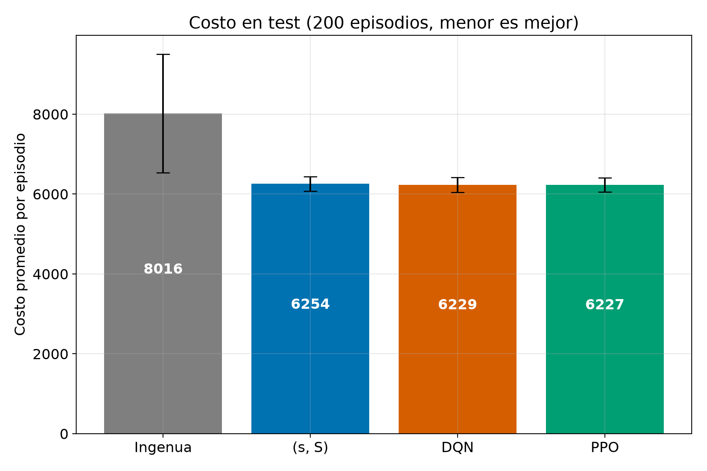

# inventario-rl: aprendizaje por refuerzo para controlar un inventario

Ejemplo en Python de **aprendizaje por refuerzo (RL)**, hecho para la exposición del curso Aprendizaje Automático (EAFIT, 2026-2).
Una tienda vende un producto y cada día decide cuánto pedirle al proveedor. La demanda es aleatoria y lo pedido tarda 3 días en llegar; si falta inventario, la venta se pierde.
El repo entrena dos algoritmos de RL (DQN y PPO) y los compara contra dos reglas de referencia (una ingenua y la clásica (s, S)).
Todo corre en CPU en unos 15 minutos y está comentado en español.
El problema se llama **control de inventarios con demanda estocástica y lead time** (*lost-sales inventory problem with lead time*).

> Si no sabes nada de RL, empieza por [`docs/CONCEPTOS.md`](docs/CONCEPTOS.md): son 5 minutos y explica todo desde cero.

## Resultado clave

Costo por episodio de 100 días en 200 episodios de test (mismas demandas para todas las políticas). Menor es mejor. DQN y PPO se entrenaron con 3 semillas.

| Politica | Costo promedio | Desv. entre episodios | Desv. entre semillas | Nivel de servicio (%) | Inventario promedio |
|---|---|---|---|---|---|
| Ingenua | 8015.7 | 1486.3 | - | 99.1 | 28.5 |
| (s, S) | 6254.2 | 183.8 | - | 96.1 | 7.5 |
| DQN | 6229.3 | 185.0 | 6.7 | 95.9 | 7.1 |
| PPO | 6227.4 | 178.8 | 29.5 | 96.6 | 7.8 |



**Qué modelo se evalúa:** durante el entrenamiento se mide el costo en validación (20 episodios, semillas 500-519) cada 10 000 pasos y se guarda el **mejor checkpoint**. Ese es el modelo que se evalúa en test y que aparece en la tabla (en `models/` quedan checkpoints de 80 000 a 300 000 pasos, no siempre el último). Es parada temprana (*early stopping*) y no contamina el test, porque la selección usa otras semillas. Hace falta porque el entrenamiento es inestable: las curvas de validación empeoran hacia el final. Medición puntual de una revisión independiente, no versionada en `results/` (semilla 0, 200 episodios de test): el modelo del último paso costó 6530.7 en PPO y 6582.2 en DQN, frente a 6220.9 y 6226.3 con el checkpoint elegido, y 6254.2 de (s, S). Es decir, el modelo final queda un 4-5 % peor que (s, S). RL llega al nivel de (s, S) **con parada temprana**, no necesariamente en el último paso.

**Lectura honesta:** RL mejora claramente a la política ingenua (~22 % menos costo). Frente a (s, S) hay **equivalencia práctica**: RL queda alrededor de un 0.4 % más barato (unos 25 puntos sobre ~6250), pero es una diferencia pequeña e inconsistente entre semillas: en 5 de 6 modelos el costo fue menor y en uno (PPO semilla 1) fue mayor. El intervalo de confianza de esa diferencia mide la variabilidad de la **demanda** entre los 200 episodios, no la del **entrenamiento**; con solo 3 semillas no se puede afirmar que RL supere a (s, S). Lo que sí se puede decir: RL iguala a una heurística clásica bien ajustada sin que nadie le diera la estructura de la regla. Detalle, intervalos y matices en [`docs/DECISIONES.md`](docs/DECISIONES.md).

## Quickstart

Requisitos: Python 3.10-3.12 (probado con 3.11.9).

```bash
python3 -m venv .venv && source .venv/bin/activate      # Windows: ver docs/GUIA_USO.md
pip install -r requirements.txt
python run_all.py --quick                               # verificación en ~1-2 min
```

Para la corrida completa (la que genera los números de arriba): `python run_all.py` (~15 min en CPU). Para ver al agente decidir día por día: `python demo.py --policy ppo --days 10`.

Ojo: `run_all.py` sobrescribe `models/` y `results/`. Para volver atrás: `git checkout -- models results`.

## Qué quiero hacer, dónde mirar

| Quiero... | Dónde mirar |
|---|---|
| Entender qué es RL, desde cero | [`docs/CONCEPTOS.md`](docs/CONCEPTOS.md) |
| Ver un día del simulador con números reales | [`docs/CONCEPTOS.md`](docs/CONCEPTOS.md), sección "Un día del simulador" |
| Entender por qué se hizo así y no de otra forma | [`docs/DECISIONES.md`](docs/DECISIONES.md) |
| Saber por qué RL no ganó claramente a (s, S) | [`docs/DECISIONES.md`](docs/DECISIONES.md), sección "Preguntas frecuentes" |
| Instalar y reproducir los resultados | [`docs/GUIA_USO.md`](docs/GUIA_USO.md), secciones 1 y 2 |
| Cambiar el problema (lead time, costos, demanda) | [`docs/GUIA_USO.md`](docs/GUIA_USO.md), sección 5, y `config.py` |
| Usar un modelo entrenado en mi código | [`docs/GUIA_USO.md`](docs/GUIA_USO.md), sección 6 |
| Agregar una política o un algoritmo | [`docs/GUIA_USO.md`](docs/GUIA_USO.md), sección 7 |
| Leer las figuras y la tabla | [`docs/GUIA_USO.md`](docs/GUIA_USO.md), sección 4 |
| Resolver un error | [`docs/GUIA_USO.md`](docs/GUIA_USO.md), sección 8 |
| Mostrarlo en vivo | `python demo.py --policy {ingenua,ss,dqn,ppo} --days 10` |

## Estructura

- `config.py`: todos los parámetros del problema y del entrenamiento.
- `inventory_env.py`: el simulador de la tienda (estilo Gymnasium).
- `policies.py`: políticas ingenua y (s, S), y la búsqueda de s y S.
- `train.py`: entrena DQN y PPO con Stable-Baselines3.
- `evaluate.py`: compara las 4 políticas y genera tabla y figuras.
- `demo.py`: imprime un episodio día por día.
- `run_all.py`: corre todo en orden (tests, búsqueda, entrenamiento, evaluación).
- `tests/test_env.py`: pruebas del entorno (`pytest`).
- `docs/`: `CONCEPTOS.md`, `DECISIONES.md` y `GUIA_USO.md`.
- `models/`: modelos entrenados de la corrida completa.
- `results/`: tabla (`metrics.md`, `metrics.csv`), `ss_params.json` y `figures/`. Los logs de entrenamiento (`results/logs/`) no se versionan.

## Qué significa "reproducible" aquí

Las semillas están fijas (entrenamiento 0-2, validación 500-519, test 1000-1199), así que el mismo código con las mismas versiones de librerías debe dar resultados muy parecidos. Pero los resultados exactos pueden variar un poco entre sistemas operativos y versiones de librerías: compara el orden de las políticas y el orden de magnitud, no los decimales. Las versiones exactas con las que se probó están en `requirements.txt`. Los resultados de `--quick` son solo una verificación de que todo corre, no una medida de rendimiento.

## Problemas comunes

- `ModuleNotFoundError`: falta activar el entorno virtual (`source .venv/bin/activate`) o terminar `pip install -r requirements.txt`.
- Versión de Python no soportada: crea el entorno con una 3.10-3.12.
- `ValueError` al evaluar tras mezclar corridas `--quick` y completas: borra `results/logs` y repite.
- Cambié un parámetro y fallan los modelos o los tests: hay que reentrenar (`rm -rf models results/logs` y `python run_all.py`); los tests y los rangos de la búsqueda (s, S) tienen valores fijos.

La lista completa con soluciones está en [`docs/GUIA_USO.md`](docs/GUIA_USO.md), sección 8.

## Lecturas recomendadas

- Mnih et al. (2015). *Human-level control through deep reinforcement learning* (DQN). *Nature*.
- Schulman et al. (2017). *Proximal Policy Optimization Algorithms*. arXiv:1707.06347.
- Gijsbrechts et al. (2022). *Can Deep Reinforcement Learning Improve Inventory Management?* *Manufacturing & Service Operations Management*.
- Sutton y Barto. *Reinforcement Learning: An Introduction* (libro gratuito en línea).
